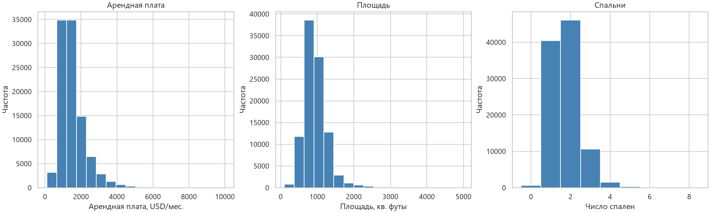
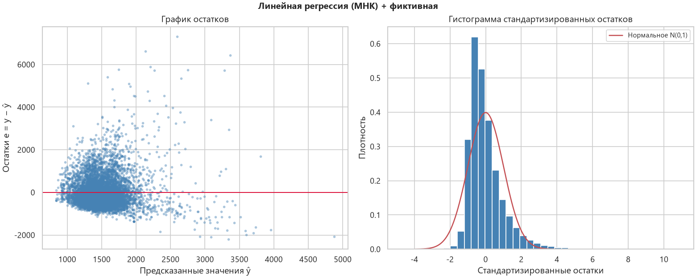
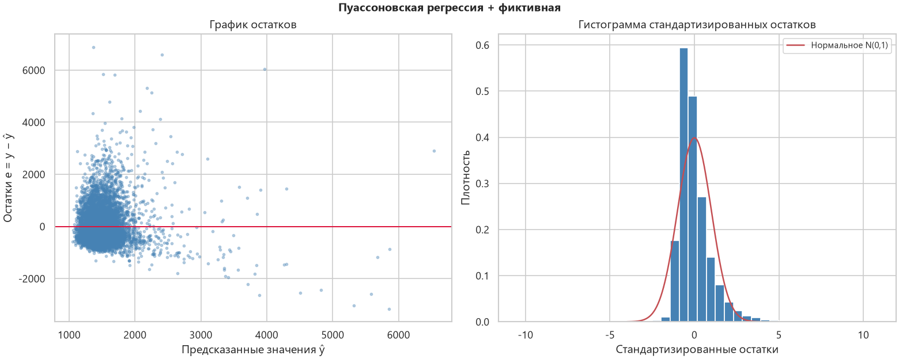
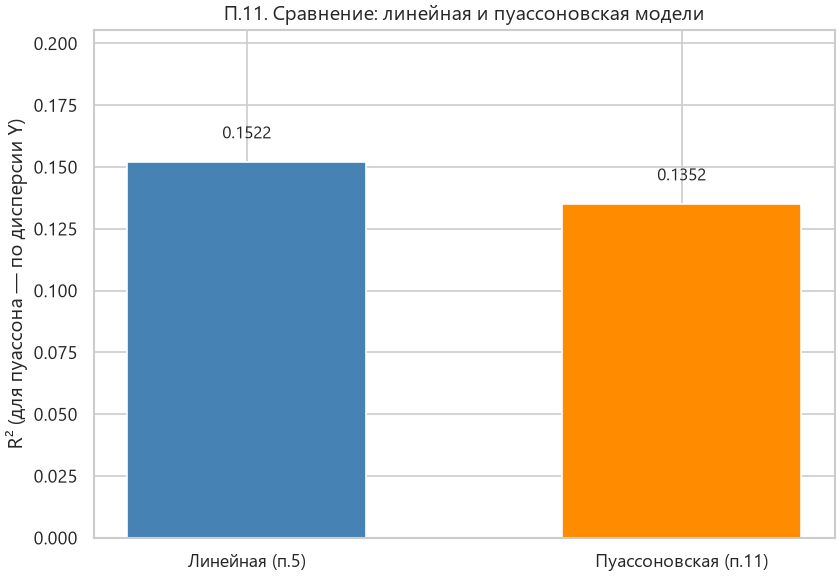
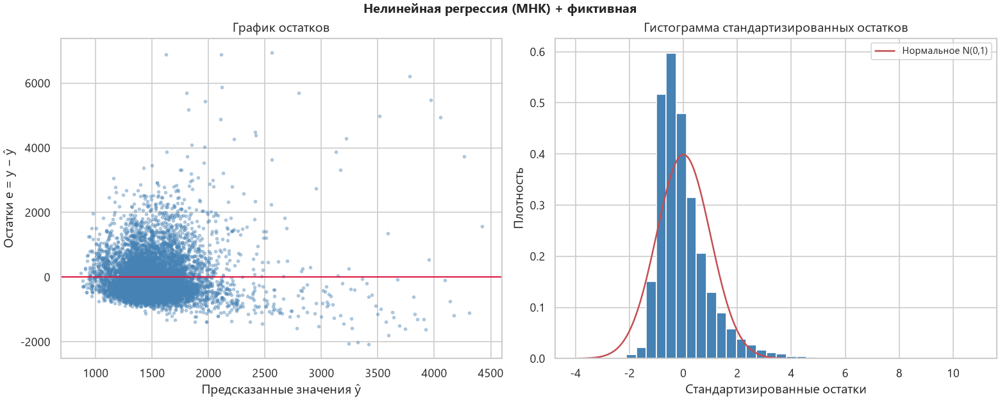
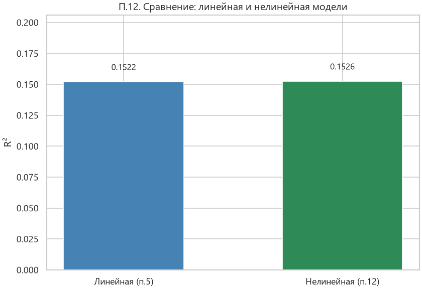
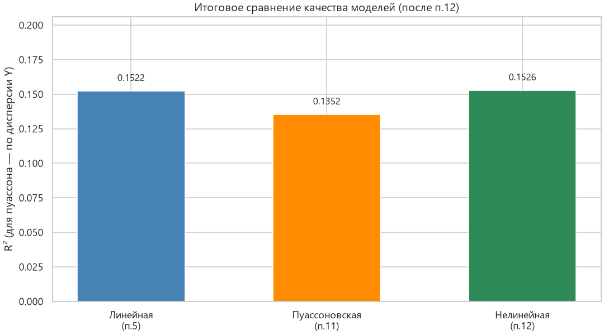

# Титульный лист

**Лабораторная работа №1.2. Регрессионный анализ**

Студент: ________________  
Группа: ________________  
Преподаватель: ________________  

---

# Отчёт. Лабораторная работа №1.2
## Регрессионный анализ

### Цель работы
Изучение регрессионного анализа.

---

### П.1. Описание исходных данных

П.1 Описание данных
Датасет: Apartment for Rent Classified (UCI #555), тот же массив, что в ЛР1.1.
n = 99602
Y (зависимая): price — арендная плата, USD/мес.
В файле цена целочисленная, по смыслу это стоимость аренды, а не число событий.
X: bedrooms — число спален (количественная дискретная);
    square_feet — площадь, кв. футы (количественная);
    pets_yes — фиктивная 0/1 из категориального pets_allowed
    (1 — можно с животными, 0 — нельзя).
pets_yes = 0: 60453 (60.7%); pets_yes = 1: 39149 (39.3%).

П.2 Дескриптивный анализ и нормальность
H0 критерия Жарка–Бера: выборка взята из нормального распределения.
  price: асимметрия=2.475, эксцесс=12.638, Жарк–Бера=7.646e+05, p=0 → не согласуется с нормальным законом при α=0.05
  bedrooms: асимметрия=0.840, эксцесс=1.363, Жарк–Бера=1.942e+04, p=0 → не согласуется с нормальным законом при α=0.05
  square_feet: асимметрия=2.316, эксцесс=12.859, Жарк–Бера=7.753e+05, p=0 → не согласуется с нормальным законом при α=0.05
Вывод: price, bedrooms и square_feet не согласуются с нормальным распределением.
У price и square_feet правосторонняя скошенность и тяжёлый правый хвост.

П.3 Гистограммы. Формула Стерджесса: k = round(1 + 3.322·lg n), h = (max − min) / k.
  1 + 3.322·lg(99602) = 17.6042, после округления k = 18.
  price: k=18, h=550.0000
  square_feet: k=18, h=270.5000
  bedrooms: формула даёт k=18, h=0.4444.
  Различных значений bedrooms — 9 (от 0 до 8).
  Дробный шаг разрезал бы целые числа спален, поэтому гистограмма построена
  по целым значениям, число столбцов = 9.

---

### П.2. Результаты дескриптивного анализа

| переменная | count | mean | std | min | 25% | 50% | 75% | max | skew | kurtosis |
|---|---|---|---|---|---|---|---|---|---|---|
| price | 99602 | 1515.31 | 759.253 | 100 | 1014 | 1350 | 1795 | 10000 | 2.4754 | 12.6387 |
| bedrooms | 99602 | 1.72619 | 0.745078 | 0 | 1 | 2 | 2 | 8 | 0.839965 | 1.36264 |
| square_feet | 99602 | 953.136 | 346.419 | 101 | 730 | 900 | 1115 | 4970 | 2.31562 | 12.86 |

Частоты фиктивной переменной:

| pets_yes | count | share |
|---|---|---|
| 0 | 60453 | 0.606946 |
| 1 | 39149 | 0.393054 |

Согласованность с нормальным распределением, критерий Жарка–Бера (H0: нормальность, α = 0,05):

| переменная | skew | kurtosis_excess | jarque_bera | p_value | normal_at_alpha |
|---|---|---|---|---|---|
| price | 2.47536 | 12.638 | 764566 | 0 | False |
| bedrooms | 0.839952 | 1.36251 | 19416.2 | 0 | False |
| square_feet | 2.31559 | 12.8593 | 775278 | 0 | False |

Вывод: `price`, `bedrooms` и `square_feet` не согласуются с нормальным распределением. У цены и площади распределение скошено вправо.

---

### П.3. Гистограммы

Число и ширина интервалов — по формуле Стерджесса, см. блок пункта 1 выше. Для `bedrooms` формула даёт дробный шаг, гистограмма построена по целым значениям.



---

### П.4. Выбор модели (линейная или пуассоновская)

П.4. Выбор модели регрессии

По заданию на этом шаге выбираем ТОЛЬКО между двумя типами:
линейная регрессия или пуассоновская регрессия.
(Нелинейная модель в п.4 не рассматривается — она появляется только в п.12.)

Критерий выбора: тип зависимой переменной Y.

1) Характеристика Y = price
   - тип: количественная непрерывная (аренда, USD/мес.);
   - область значений: [100; 10000], среднее = 1515.31;
   - не является счётной величиной (числом событий / целым «count»).

2) Когда уместна линейная регрессия (МНК)
   - Y непрерывна (или близка к непрерывной);
   - моделируем E[Y|X] = β0 + β1·X1 + … как линейную комбинацию признаков;
   - коэффициенты оцениваются методом наименьших квадратов.
   → для price линейная модель подходит по типу Y.

3) Когда уместна пуассоновская регрессия
   - Y — неотрицательные целые счётные данные (число заявок, аварий и т.п.);
   - моделируется E[Y|X] = exp(Xβ), дисперсия связана со средним.
   → price — не count-переменная; пуассон для арендной платы формально применим
     только после округления Y до целых долларов, но по смыслу типа данных
     это менее естественный выбор.

4) Решение по п.4
   Выбираем ЛИНЕЙНУЮ регрессию как основную модель для п.5–10, потому что:
   - Y непрерывна → соответствует предпосылкам линейной модели;
   - цель — прогноз уровня арендной платы, а не интенсивности счётного процесса.

   Пуассоновская модель будет построена отдельно по требованию п.11
   (обязательный пункт задания), но НЕ является выбором п.4.

Фиктивная переменная (для п.5): pets_yes ∈ {0,1} из категориального pets_allowed
(1 — можно с животными, 0 — нельзя).


---

### П.5–10. Линейная регрессия с фиктивными переменными

**Уравнение:** `ŷ = 757.301238 - 74.857212*bedrooms + 0.955403*square_feet - 59.537031*pets_yes`

| Показатель | Значение |
|------------|----------|
| R² | 0.1522 |
| R²_adj | 0.1521 |
| F (p-value) | 5958.33 (0) |
| Модель значима (α=0.05) | True |
| RMSE | 699.10 |



Коэффициенты: `results/05_linear_coefficients.csv`.

#### Обоснование п.6–10 (линейная)

```
Обоснование п.6–10 для модели: Линейная регрессия (МНК) + фиктивная (линейная МНК)

П.6. График остатков. Постоянство среднего и дисперсии
- График: figures/05_linear_residuals.png (левая панель: остатки e против предсказанных ŷ).
- Общее среднее остатков mean(e) = -1.30906e-11.
  У модели со свободным членом оно близко к нулю по построению.
  Постоянство среднего проверяется по уровням ŷ, а не по этому числу.
- Среднее и дисперсия остатков по квартилям ŷ:
  ŷ∈(771.9490000000001, 1341.034]: mean(e)=15.89, var(e)=339763.9
  ŷ∈(1341.034, 1472.562]: mean(e)=-44.49, var(e)=337135.5
  ŷ∈(1472.562, 1648.021]: mean(e)=-20.51, var(e)=428993.8
  ŷ∈(1648.021, 5214.858]: mean(e)=49.17, var(e)=844426.6
- Наибольший |mean(e)| по квартилям = 49.17 при sd(e) = 699.11
  (отношение 0.070). Критерий: отношение < 0.15 — сдвиг мал на фоне разброса.
  Вывод по среднему: среднее остатков по уровню ŷ примерно постоянно.
- Отношение max/min дисперсий по квартилям ŷ = 2.5047.
- Тест Breusch–Pagan: LM=3608.03, p=0 < α=0.05 → гетероскедастичность (дисперсия остатков не постоянна).

П.7. Гистограмма стандартизированных остатков
- Файл: figures/05_linear_residuals.png (правая панель).
- Асимметрия станд. остатков = 2.1620; эксцесс = 9.8458.
- Критерий близости к N(0,1): |асимметрия| < 0.5 и визуальное совпадение с кривой плотности.
  Вывод: распределение остатков скошено; нормальность остатков не выполняется.

П.8. Уравнение регрессии
ŷ = 757.301238 - 74.857212*bedrooms + 0.955403*square_feet - 59.537031*pets_yes

П.9. Оценка качества (R², график и гистограмма остатков)
- R² = 0.152162; R²_adj = 0.152137; RMSE = 699.1021.
- R²=0.1522 < 0.3 — модель объясняет малую долю дисперсии Y; прогностическое качество слабое, хотя связь может быть статистически значимой.
- По графику остатков: среднее по уровням ŷ примерно постоянно — да; постоянство дисперсии — см. п.6.
- По гистограмме: см. п.7 (асимметрия=2.16).
- Итог по качеству: модель формально пригодна для описания средней связи, но R² низкий — большая часть вариации цены не объяснена включёнными X.

П.10. Значимость модели и коэффициентов
- Критерий значимости уравнения: p-value теста модели < α=0.05.
- F = 5958.3263, p = 0 →
  модель значима при α=0.05.
- Значимость коэффициентов (H0: βj=0), α=0.05:
  - const: коэффициент=757.301, p=0 → значим при α=0.05
  - bedrooms: коэффициент=-74.8572, p=7.183e-69 → значим при α=0.05
  - square_feet: коэффициент=0.955403, p=0 → значим при α=0.05
  - pets_yes: коэффициент=-59.537, p=2.855e-39 → значим при α=0.05

Вывод по п.6–10: уравнение статистически значимо;
качество по R² низкое; остатки —
среднее по уровням ŷ примерно постоянно, гомоскедастичность отвергается.

```

---

### П.11. Пуассоновская регрессия (+ п.6–10)

**Уравнение:** `log(μ) = 6.912634 - 0.025002*bedrooms + 0.000478*square_feet - 0.039364*pets_yes ;  μ = E[Y] = exp(…)`

| Показатель | Значение |
|------------|----------|
| R² (по дисперсии Y) | 0.1352 |
| R²_adj | 0.1351 |
| McFadden pseudo-R² | 0.1516 |
| φ (χ² Пирсона / df) | 307.09 |
| Квази-LR (p-value) | 16042.66 (0) |
| LR Пуассона при φ=1 (не используется) | 4926617.72 |
| Модель значима по квази-LR | True |
| RMSE | 706.08 |





#### Обоснование п.6–10 (пуассон)

```
Обоснование п.6–10 для модели: Пуассоновская регрессия + фиктивная (пуассоновская)

П.6. График остатков. Постоянство среднего и дисперсии
- График: figures/11_poisson_residuals.png (левая панель: остатки e против предсказанных ŷ).
- Общее среднее остатков mean(e) = -4.05248e-11.
  У модели со свободным членом оно близко к нулю по построению.
  Постоянство среднего проверяется по уровням ŷ, а не по этому числу.
- Среднее и дисперсия остатков по квартилям ŷ:
  ŷ∈(1015.177, 1361.163]: mean(e)=-38.49, var(e)=333281.3
  ŷ∈(1361.163, 1462.687]: mean(e)=-46.36, var(e)=337291.7
  ŷ∈(1462.687, 1604.904]: mean(e)=1.81, var(e)=434234.1
  ŷ∈(1604.904, 9725.49]: mean(e)=83.05, var(e)=878996.0
- Наибольший |mean(e)| по квартилям = 83.05 при sd(e) = 706.08
  (отношение 0.118). Критерий: отношение < 0.15 — сдвиг мал на фоне разброса.
  Вывод по среднему: среднее остатков по уровню ŷ примерно постоянно.
- Отношение max/min дисперсий по квартилям ŷ = 2.6374.
- Тест Breusch–Pagan: LM=5167.14, p=0 < α=0.05 → гетероскедастичность (дисперсия остатков не постоянна).

П.7. Гистограмма стандартизированных остатков
- Файл: figures/11_poisson_residuals.png (правая панель).
- Асимметрия станд. остатков = 1.9667; эксцесс = 9.9070.
- Критерий близости к N(0,1): |асимметрия| < 0.5 и визуальное совпадение с кривой плотности.
  Вывод: распределение остатков скошено; нормальность остатков не выполняется.

П.8. Уравнение регрессии
log(μ) = 6.912634 - 0.025002*bedrooms + 0.000478*square_feet - 0.039364*pets_yes ;  μ = E[Y] = exp(…)

П.9. Оценка качества (R², график и гистограмма остатков)
- R² = 0.135155; R²_adj = 0.135129; RMSE = 706.0793.
- R²=0.1352 < 0.3 — модель объясняет малую долю дисперсии Y; прогностическое качество слабое, хотя связь может быть статистически значимой.
- По графику остатков: среднее по уровням ŷ примерно постоянно — да; постоянство дисперсии — см. п.6.
- По гистограмме: см. п.7 (асимметрия=1.97).
- Итог по качеству: модель формально пригодна для описания средней связи, но R² низкий — большая часть вариации цены не объяснена включёнными X.

П.10. Значимость модели и коэффициентов
- Критерий значимости уравнения: p-value теста модели < α=0.05.
- Оценки коэффициентов — пуассоновский ММП. φ = 307.09, √φ = 17.52: стандартные ошибки умножены на √φ. Обычный LR = 4926617.7 (p=0) предполагает Var(Y)=μ и в вывод о значимости не входит. Используется квази-LR = LR/φ = 16042.66, p=0.
- квази-LR (LR/φ) = 16042.6568, p = 0 →
  модель значима при α=0.05.
- Значимость коэффициентов (H0: βj=0), α=0.05:
  - const: коэффициент=6.91263, p=0 → значим при α=0.05
  - bedrooms: коэффициент=-0.0250025, p=1.207e-21 → значим при α=0.05
  - square_feet: коэффициент=0.000477895, p=0 → значим при α=0.05
  - pets_yes: коэффициент=-0.039364, p=8.466e-41 → значим при α=0.05

Вывод по п.6–10: уравнение статистически значимо;
качество по R² низкое; остатки —
среднее по уровням ŷ примерно постоянно, гомоскедастичность отвергается.

```

#### Сравнение линейной и пуассоновской (без нелинейной)

```
П.11. Пуассоновская регрессия — сравнение с линейной (альтернативы п.4)

На этом шаге сравниваем ТОЛЬКО две модели из п.4: линейную и пуассоновскую.
Нелинейная модель ещё не построена (она появится в п.12).

Одинаковые независимые переменные: bedrooms, square_feet, pets_yes.

| Показатель | Линейная (п.5) | Пуассон (п.11) | Лучше по показателю |
|------------|----------------|----------------|---------------------|
| R² (доля объяснённой дисперсии Y) | 0.152162 | 0.135155 | линейная |
| R²_adj | 0.152137 | 0.135129 | линейная |
| RMSE (меньше — лучше) | 699.1021 | 706.0793 | линейная |
| Значимость модели (α=0.05) | True (F, p=0) | True (квази-LR, p=0) | обе значимы |
| φ = χ² Пирсона / df (только пуассон) | — | 307.09 | — |
| Pseudo-R² McFadden (только пуассон) | — | 0.151572 | — |

Обоснование вывода после п.11:
1) По типу Y (п.4) линейная модель уместнее: price — арендная плата, а не число событий.
2) По качеству аппроксимации: R² линейной (0.1522) > R²(var) пуассона (0.1352).
3) По ошибке прогноза: RMSE линейной (699.10) < RMSE пуассона (706.08).
4) Линейная модель значима по F. Пуассоновская значима по квази-LR = LR/φ.
   φ = 307.09 при требуемом для Пуассона φ ≈ 1, поэтому обычные z и LR
   (LR = 4926617.7) в оценку значимости не входят.
5) Дисперсия сырых остатков пуассоновской модели не постоянна: Breusch–Pagan p=0.
6) Итог: выбор п.4 подтверждается. Линейная модель лучше по типу Y, по R² и по RMSE.

```

---

### П.12. Нелинейная регрессия с фиктивными переменными (+ п.6–10)

Нелинейная модель появляется **только в этом пункте**.

Спецификация: `price ~ square_feet + square_feet² + square_feet²·log(square_feet) + bedrooms + pets_yes`.

**Уравнение:** `ŷ = 890.050234 + 0.489901*square_feet + 0.001567*square_feet_sq - 0.000178*square_feet_sq_log - 80.419544*bedrooms - 59.190207*pets_yes`

| Показатель | Значение |
|------------|----------|
| R² | 0.1526 |
| R²_adj | 0.1526 |
| F (p-value) | 3587.81 (0) |
| Модель значима | True |
| RMSE | 698.91 |
| Число обусловленности | 1.337e+08 |





#### Обоснование п.6–10 (нелинейная)

```
Обоснование п.6–10 для модели: Нелинейная регрессия (МНК) + фиктивная (нелинейная МНК)

П.6. График остатков. Постоянство среднего и дисперсии
- График: figures/12_nonlinear_residuals.png (левая панель: остатки e против предсказанных ŷ).
- Общее среднее остатков mean(e) = -1.30984e-09.
  У модели со свободным членом оно близко к нулю по построению.
  Постоянство среднего проверяется по уровням ŷ, а не по этому числу.
- Среднее и дисперсия остатков по квартилям ŷ:
  ŷ∈(843.13, 1337.669]: mean(e)=13.27, var(e)=340633.4
  ŷ∈(1337.669, 1467.085]: mean(e)=-39.02, var(e)=336040.0
  ŷ∈(1467.085, 1647.432]: mean(e)=-16.06, var(e)=428642.4
  ŷ∈(1647.432, 4550.533]: mean(e)=41.87, var(e)=845807.0
- Наибольший |mean(e)| по квартилям = 41.87 при sd(e) = 698.91
  (отношение 0.060). Критерий: отношение < 0.15 — сдвиг мал на фоне разброса.
  Вывод по среднему: среднее остатков по уровню ŷ примерно постоянно.
- Отношение max/min дисперсий по квартилям ŷ = 2.5170.
- Тест Breusch–Pagan: LM=4466.13, p=0 < α=0.05 → гетероскедастичность (дисперсия остатков не постоянна).

П.7. Гистограмма стандартизированных остатков
- Файл: figures/12_nonlinear_residuals.png (правая панель).
- Асимметрия станд. остатков = 2.1636; эксцесс = 9.8472.
- Критерий близости к N(0,1): |асимметрия| < 0.5 и визуальное совпадение с кривой плотности.
  Вывод: распределение остатков скошено; нормальность остатков не выполняется.

П.8. Уравнение регрессии
ŷ = 890.050234 + 0.489901*square_feet + 0.001567*square_feet_sq - 0.000178*square_feet_sq_log - 80.419544*bedrooms - 59.190207*pets_yes

П.9. Оценка качества (R², график и гистограмма остатков)
- R² = 0.152627; R²_adj = 0.152585; RMSE = 698.9104.
- R²=0.1526 < 0.3 — модель объясняет малую долю дисперсии Y; прогностическое качество слабое, хотя связь может быть статистически значимой.
- По графику остатков: среднее по уровням ŷ примерно постоянно — да; постоянство дисперсии — см. п.6.
- По гистограмме: см. п.7 (асимметрия=2.16).
- Итог по качеству: модель формально пригодна для описания средней связи, но R² низкий — большая часть вариации цены не объяснена включёнными X.

П.10. Значимость модели и коэффициентов
- Критерий значимости уравнения: p-value теста модели < α=0.05.
- Число обусловленности = 1.337e+08. VIF: square_feet=161.7, square_feet_sq=11845.6, square_feet_sq_log=9478.1, bedrooms=2.2, pets_yes=1.0. Столбцы square_feet, square_feet² и square_feet²·log почти линейно зависимы. t-критерии формально отклоняют нулевые коэффициенты этих членов, но их знаки по отдельности не интерпретируются. Вклад формы виден по приросту R².
- F = 3587.8102, p = 0 →
  модель значима при α=0.05.
- Значимость коэффициентов (H0: βj=0), α=0.05:
  - const: коэффициент=890.05, p=1.865e-235 → значим при α=0.05
  - square_feet: коэффициент=0.489901, p=1.683e-09 → значим при α=0.05
  - square_feet_sq: коэффициент=0.00156656, p=5.605e-11 → значим при α=0.05
  - square_feet_sq_log: коэффициент=-0.000177864, p=3.161e-11 → значим при α=0.05
  - bedrooms: коэффициент=-80.4195, p=9.356e-76 → значим при α=0.05
  - pets_yes: коэффициент=-59.1902, p=7.571e-39 → значим при α=0.05

Вывод по п.6–10: уравнение статистически значимо;
качество по R² низкое; остатки —
среднее по уровням ŷ примерно постоянно, гомоскедастичность отвергается.

```

#### Сравнение линейной и нелинейной

```
П.12. Нелинейная регрессия — сравнение с линейной (п.5)

Нелинейная модель появляется ТОЛЬКО в этом пункте (в п.4 её не было).
Спецификация по заданию (линейная свёртка нелинейных элементов):
  price ~ square_feet + square_feet² + square_feet²·log(square_feet) + bedrooms + pets_yes

| Показатель | Линейная (п.5) | Нелинейная (п.12) | Δ (нелин − лин) |
|------------|----------------|-------------------|-----------------|
| R² | 0.152162 | 0.152627 | +0.000465 |
| R²_adj | 0.152137 | 0.152585 | +0.000448 |
| RMSE (меньше — лучше) | 699.1021 | 698.9104 | изменение RMSE: -0.1916 |
| Число регрессоров k | 3 | 5 | +2 |
| Значимость модели | True | True | — |

Обоснование:
1) Число обусловленности = 1.337e+08. VIF: square_feet=161.7, square_feet_sq=11845.6, square_feet_sq_log=9478.1, bedrooms=2.2, pets_yes=1.0.
   Квадрат площади и square_feet²·log имеют VIF в тысячи: члены описывают одну и ту же
   кривизну и по отдельности не читаются. Формула в задании (x³ и x²·log x) — пример
   линейной свёртки; здесь свёртка x, x² и x²·log x.
2) Прирост качества: ΔR²_adj = +0.000448
   < 0.01 → прирост практически пренебрежим.
3) RMSE изменился на 0.1916 USD при среднем price ≈ 1515.
4) Итог п.12: уравнение значимо, как и линейное. Прирост качества пренебрежим,
   коэффициенты нелинейных членов площади не интерпретируются.
   Для содержательного вывода достаточно линейной модели п.5.

```

---

### Итог (после всех пунктов)

Итоговое сравнение и интерпретация

Порядок по заданию:
- п.4: между линейной и пуассоновской выбрана линейная, потому что Y — арендная плата;
- п.5–10: линейная модель с фиктивной pets_yes;
- п.11: пуассоновская; по R² и RMSE она хуже линейной;
- п.12: нелинейная свёртка. Наибольший R² у модели «Нелинейная (п.12)»,
  прирост R²_adj к линейной пренебрежим, столбцы площади почти коллинеарны.

Интерпретация линейного уравнения (п.5), при прочих включённых признаках:
- свободный член 757.30 — уровень уравнения при нулевых X.
  Площадь в данных не бывает нулевой, поэтому свободный член не является ценой реальной квартиры.
- square_feet: 0.955 USD за квадратный фут.
  Парная корреляция цены и площади = 0.385.
- bedrooms: -74.86 USD за дополнительную спальню при фиксированной площади.
  Парная корреляция цены и числа спален положительная (0.240):
  в среднем квартира с большим числом спален дороже, потому что она больше
  (корреляция bedrooms и square_feet = 0.717).
  Минус в уравнении — частный эффект при той же площади: комнаты оказываются меньше.
- pets_yes: -59.54 USD, если животные разрешены.
  Это связь в объявлениях, а не эффект «животные снижают цену».

Средняя плата по числу спален (без учёта площади):
  0 спален: n=659, средняя плата = 1320.4 USD
  1 спален: n=40470, средняя плата = 1346.9 USD
  2 спален: n=46109, средняя плата = 1574.7 USD
  3 спален: n=10569, средняя плата = 1764.2 USD
  4 спален: n=1486, средняя плата = 2220.6 USD

Пуассоновская модель: φ = 307.09. Значимость взята по квази-LR.
Дисперсия её сырых остатков не постоянна.

Нелинейная модель: число обусловленности = 1.337e+08, VIF: square_feet=161.7, square_feet_sq=11845.6, square_feet_sq_log=9478.1, bedrooms=2.2, pets_yes=1.0.
Коэффициенты square_feet, square_feet² и square_feet²·log по отдельности не интерпретируются.

Общий вывод: все три уравнения статистически значимы при n = 99602.
R² около 0,15: выбранные признаки оставляют необъяснённой большую часть разброса цены.
Рабочая модель — линейная из п.5.

Данные: n=99602, Y=price, X=bedrooms, square_feet, pets_yes.


Сводная таблица: `results/13_model_comparison.csv`.



### Как запустить
```bash
D:\mad_lab2_venv\Scripts\python.exe lab2_regression.py
```
